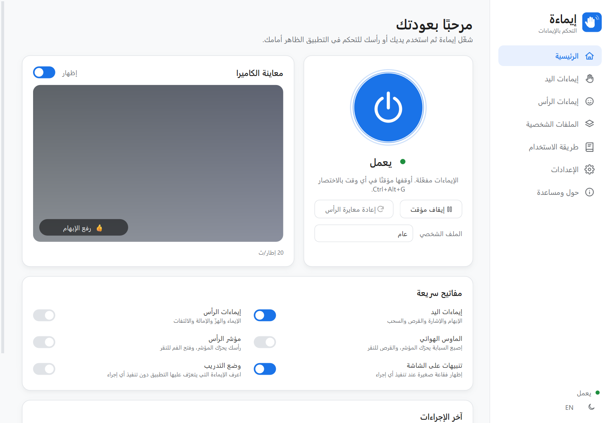
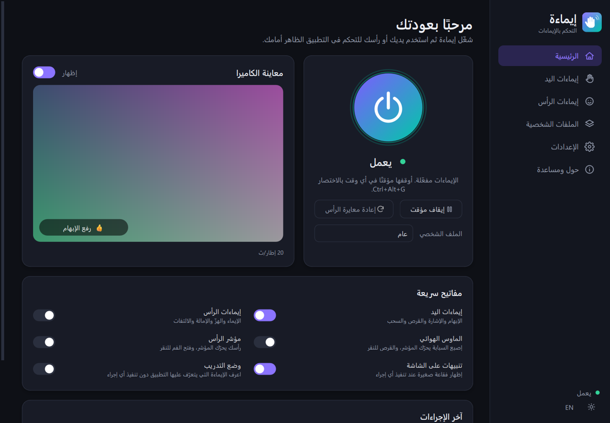

  

<h3 align="center">تحكّم دون لمس · Control Without Contact</h3>

  <b>تحكّم في حاسوبك وهاتفك بتلويحة يد أو إيماءة رأس — بخصوصية تامة.</b> 
  كل شيء يحدث على جهازك. لا يُسجَّل أي فيديو ولا يُحفظ ولا يُرسل إلى أي مكان.

  <a href="https://momen-ibrahim-fawzy.github.io/movo/"><b>🌐 الموقع</b></a> ·
  <a href="README.md">English</a> ·
  <a href="docs/USER_GUIDE.ar.md">دليل المستخدم</a> ·
  <a href="docs/PRIVACY.md">الخصوصية</a>

  
  

## الحصول على التطبيق

كل ملفات التنزيل موجودة في **[صفحة الإصدارات](../../releases/latest)**، وتُبنى تلقائيًا لكل نظام عند كل إصدار.

| جهازك | الملف |
|-------|-------|
| ويندوز 10 / 11 | `Movo-Setup-x.y.z.exe` (برنامج تثبيت) أو `Movo-Windows-x64-portable.zip` |
| ماك بمعالج Apple (M1 أو أحدث) | `Movo-macOS-macos-arm64.dmg` |
| ماك بمعالج Intel | `Movo-macOS-macos-x86_64.dmg` |
| لينكس | `Movo-Linux-x86_64.AppImage` |
| أندرويد 8 أو أحدث | `Movo-Android.apk` |
| آيفون / آيباد | البناء عبر Xcode |
| مساعد المتصفح (اختياري لتخطي الإعلانات) | `Movo-Browser-Helper.zip` |

### ويندوز
1. نزّل **Movo-Setup-x.y.z.exe** وانقر عليه مرتين (لا يحتاج صلاحيات المسؤول).
2. إذا ظهرت رسالة *«حماية Windows لجهازك»* اضغط **مزيد من المعلومات ← التشغيل على أي حال**.
3. افتح **Movo** من قائمة ابدأ.

### ماك
1. نزّل ملف `.dmg` المناسب لجهازك، وافتحه واسحب **Movo** إلى **التطبيقات**.
2. إذا لم يستطع النظام التحقق من التطبيق: **إعدادات النظام ← الخصوصية والأمان ← الفتح على أي حال**.
3. اسمح بالكاميرا، وفعّل التطبيق في **تسهيلات الاستخدام** عند ظهور الشريط الأصفر، ثم أعد فتحه.

### أندرويد
1. نزّل **Movo-Android.apk** على الهاتف وافتحه.
2. افتح التطبيق، واضغط **تفعيل** في بطاقة *التحكم في الهاتف*، وفعّل **التحكم بالإيماءات - موفو** في تسهيلات الاستخدام.
3. اضغط زر التشغيل واسمح بالكاميرا.

## طريقة الاستخدام

1. **ابدأ** — اضغط زر التشغيل الأزرق الكبير في الصفحة الرئيسية.
2. **واجه الكاميرا** — اجلس على بُعد 40–100 سم مع إضاءة أمامك، وارفع يدك وكفّك نحو الشاشة.
3. **اصنع الإيماءة واثبت عليها** نصف ثانية — جرّب 👍. تظهر فقاعة صغيرة تؤكد ما حدث.
4. **انقر مرة على التطبيق الذي تريد التحكم فيه** (الشرائح أو الفيديو أو المتصفح).
5. **أوقف مؤقتًا** بعلامة 🤘 أو زر *إيقاف مؤقت* أو **Ctrl + Alt + G**.
6. افتح صفحة **طريقة الاستخدام** داخل التطبيق للدليل الكامل، و**وضع التدريب** لتعلّم الإيماءات بأمان.

## ماذا يفعل التطبيق؟

| الفئة | ما يمكنك فعله دون لمس |
|-------|----------------------|
| 🔊 الصوت والوسائط | رفع الصوت وخفضه، الكتم، التشغيل والإيقاف، المقطع التالي والسابق |
| 📽️ العروض التقديمية | الشريحة التالية والسابقة، الشاشة السوداء، بدء العرض |
| 📜 القراءة | التمرير للأعلى وللأسفل (السرعة تتبع يدك)، التكبير والتصغير |
| 📑 التصفح | التنقل بين علامات التبويب، الرجوع والتقدم، فتح وإغلاق علامة تبويب |
| 📸 لقطة الشاشة | تُحفظ في مجلد الصور/Movo وتُنسخ إلى الحافظة |
| 🎙️ المكالمات | تشغيل الميكروفون وكتمه على مستوى النظام |
| ⏩ الإعلانات | تخطي الإعلانات بالضغط على زر «تخطي» الظاهر نيابةً عنك |
| 👁️ العينان فقط | غمزة يسرى/يمنى، رمشة مزدوجة أو طويلة، إغماض العينين، النظر للأعلى/للأسفل — مع النظارة أو بدونها |
| 🖱️ الماوس | الماوس الهوائي (بإصبع السبابة) أو مؤشر الرأس (فتح الفم للنقر) |
| ⌨️ أي شيء آخر | اربط أي إيماءة بأي اختصار من لوحة المفاتيح |

### الإيماءات الافتراضية

| اليد | الإجراء | الرأس | الإجراء |
|------|---------|-------|---------|
| 👍 رفع الإبهام | رفع الصوت | 🙂 إيماءة | تشغيل / إيقاف |
| 👎 خفض الإبهام | خفض الصوت | 🙅 هزّ الرأس | تخطي الإعلان |
| 👉 الإشارة يمينًا | التالي | ↗️ إمالة لليمين | التالي |
| 👈 الإشارة يسارًا | السابق | ↖️ إمالة لليسار | السابق |
| 🤏 قرص | تشغيل / إيقاف | ⬆️ النظر للأعلى | تمرير للأعلى |
| ☝️ السبابة مع الحركة | التمرير | ⬇️ النظر للأسفل | تمرير للأسفل |
| 🤏 قرص وسحب | تكبير / تصغير | ➡️ الالتفات يمينًا | علامة التبويب التالية |
| ✋ سحب يمينًا / يسارًا | علامة التبويب التالية / السابقة | ⬅️ الالتفات يسارًا | علامة التبويب السابقة |
| ✌️ علامة النصر | لقطة شاشة | 😮 فتح الفم \* | تشغيل / كتم الميكروفون |
| 🤙 علامة الاتصال | تشغيل / كتم الميكروفون | 😁 ابتسامة \* | لقطة شاشة |
| ✊ قبضة | تخطي الإعلان | | |
| 🤘 علامة الروك | إيقاف / استئناف موفو | | |

\* في وضع الرأس «الدقيق». يمكن تغيير أي إيماءة أو إيقافها، أو تخصيصها لكل **ملف شخصي**
(عام، عرض تقديمي، وسائط، المتصفح، اجتماع)، ويتم التبديل تلقائيًا حسب التطبيق الظاهر أمامك.

### مصمَّم للجميع

- **التشغيل والإيقاف والإيقاف المؤقت من داخل التطبيق** — زر التشغيل الكبير، أو قائمة شريط المهام، أو الاختصار **Ctrl + Alt + G** من أي مكان.
- **العربية والإنجليزية** مع اتجاه كامل من اليمين إلى اليسار، و**سمة فاتحة أو داكنة أو حسب النظام**.
- **وضع التدريب** يُظهر الإيماءة التي يراها التطبيق دون تنفيذ أي إجراء.
- **إيماءات الرأس ومؤشر الرأس** لمن لا يستطيع استخدام يديه.
- **الهاتف ككاميرا عن بُعد** — يتعرّف تطبيق الهاتف على الإيماءة ويرسل اسمها فقط عبر شبكة Wi-Fi.
- **استهلاك منخفض للموارد** — نحو 10–20 مللي ثانية من المعالج لكل إطار، ويرتاح عند عدم وجود أحد.

## الخصوصية

لا ينظر التطبيق إلى الكاميرا إلا أثناء تشغيله. تُحلَّل كل صورة في الذاكرة ثم تُستبدل بالتالية — لا يوجد أي كود يكتب
صور الكاميرا على القرص أو يرسلها عبر الشبكة. لا حسابات ولا تحليلات ولا إعلانات.

## الترخيص

© 2026 مؤمن إبراهيم فوزي. جميع الحقوق محفوظة.

