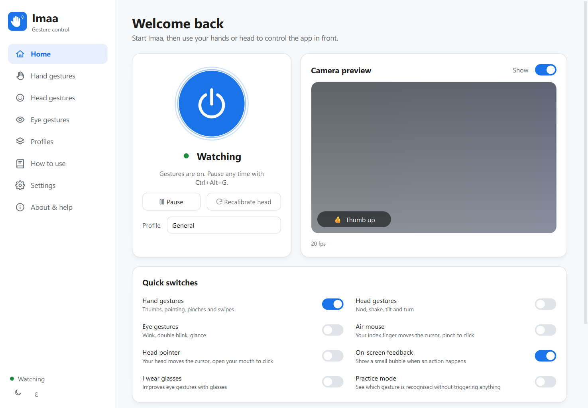

<p align="center">
  
</p>

<h1 align="center">Imaa · إيماءة</h1>

<p align="center">
  <b>Control your computer and phone with a wave of your hand or a nod of your head — privately.</b><br/>
  Everything happens on your device. No video is recorded, saved or sent anywhere.
</p>

<p align="center">
  <a href="#get-the-app"><b>⬇ Get the app</b></a> ·
  <a href="#how-to-use"><b>How to use</b></a> ·
  <a href="README.ar.md">العربية</a> ·
  <a href="docs/USER_GUIDE.md">User guide</a> ·
  <a href="docs/PLAN.md">Plan</a> ·
  <a href="docs/ARCHITECTURE.md">Architecture</a> ·
  <a href="docs/PRIVACY.md">Privacy</a>
</p>

<p align="center">
  
  
</p>

---

## What it does

| Category | What you can do hands-free |
|----------|----------------------------|
| 🔊 Sound & media | Volume up / down, mute, play / pause, next / previous track |
| 📽️ Presentations | Next / previous slide, black screen, start the slideshow |
| 📜 Reading | Scroll up / down (speed follows your hand), zoom in / out |
| 📑 Browsing | Next / previous tab, back / forward, new / close tab |
| 📸 Screenshot | Saved to *Pictures/Imaa* and copied to the clipboard |
| 🎙️ Calls | Microphone on / off for the whole system |
| ⏩ Ads | Skip ads by pressing the visible *Skip* button for you |
| 👁️ Eyes only | Wink left/right, double blink, long blink, close your eyes, glance up/down — with or without glasses |
| 🖱️ Mouse | Air mouse (index finger) or head pointer (head + open mouth to click) |
| ⌨️ Anything else | Bind any gesture to any keyboard shortcut |

### Default gestures

| Hand | Action | Head | Action |
|------|--------|------|--------|
| 👍 Thumb up (hold) | Volume up | 🙂 Nod | Play / pause |
| 👎 Thumb down (hold) | Volume down | 🙅 Shake | Skip ad |
| 👉 Point right | Next | ↗️ Tilt right | Next |
| 👈 Point left | Previous | ↖️ Tilt left | Previous |
| 🤏 Pinch | Play / pause | ⬆️ Look up (hold) | Scroll up |
| ☝️ Index up + move | Scroll | ⬇️ Look down (hold) | Scroll down |
| 🤏 Pinch, hold & pull | Zoom in / out | ➡️ Turn right | Next tab |
| ✋ Swipe right / left | Next / previous tab | ⬅️ Turn left | Previous tab |
| ✌️ Victory | Screenshot | 😮 Open mouth \* | Microphone on / off |
| 🤙 Call sign | Microphone on / off | 😁 Smile \* | Screenshot |
| ✊ Fist | Skip ad | | |
| 🤘 Rock sign (hold) | Pause / resume Imaa | | |

| Eyes (with or without glasses) | Action |
|------|--------|
| 😉 Wink left / right | Previous / next |
| 👁️ Double blink | Play / pause |
| 😌 Long blink (~1 s) | Skip ad |
| 😴 Eyes closed 2 s | Pause / resume Imaa |
| 🔼 / 🔽 Glance up / down (hold) | Scroll |

Normal blinking is ignored. A 7-second calibration adapts eye gestures to your eyes and your glasses — see [EYE_GESTURES.md](docs/EYE_GESTURES.md).

\* *Accurate* head mode. Every gesture can be re-assigned, switched off, or set per **profile**
(General, Presentation, Media, Browser, Meeting — Imaa switches automatically for the app in front).

### Built for everyone

- **Start, stop and pause inside the app** — big power button, tray menu, or **Ctrl + Alt + G** anywhere.
- **English and Arabic** with a full right-to-left layout, **light, dark or system** theme — switch instantly.
- **Practice mode** shows which gesture Imaa sees without doing anything.
- **Head gestures, head pointer and eye gestures** for people who can't use their hands.
- **Phone as a remote camera** — the phone app recognises gestures and sends only the gesture name to the computer over your Wi-Fi.
- **Light on resources** — about 10–20 ms of CPU per frame; rests at 5 fps when nobody is in view; Eco mode for older laptops.

## Get the app

All downloads are on the **[Releases page](../../releases/latest)**. Every tagged version is built automatically for each platform.

| Your device | Download |
|-------------|----------|
| Windows 10 / 11 | `Imaa-Setup-x.y.z.exe` (installer) or `Imaa-Windows-x64-portable.zip` |
| Mac with Apple Silicon (M1 or newer) | `Imaa-macOS-macos-arm64.dmg` |
| Mac with Intel | `Imaa-macOS-macos-x86_64.dmg` |
| Linux (Ubuntu, Fedora, …) | `Imaa-Linux-x86_64.AppImage` or `.tar.gz` |
| Android 8+ phone, tablet or Chromebook | `Imaa-Android.apk` |
| iPhone / iPad (iOS 16+) | Build with Xcode (see below) |
| Chrome, Edge, Brave, Firefox (optional, for ad skipping) | `Imaa-Browser-Helper.zip` |

### Windows
1. Download **Imaa-Setup-x.y.z.exe** and double-click it. No administrator rights needed.
2. If you see *"Windows protected your PC"*, click **More info → Run anyway**.
3. Open **Imaa** from the Start menu.

### macOS
1. Download the `.dmg` that matches your Mac (Apple menu → *About This Mac* shows "Apple M…" or "Intel").
2. Open it and drag **Imaa** onto **Applications**, then open it from Applications.
3. If macOS says it can't verify the app: **System Settings → Privacy & Security → Open Anyway**.
4. Allow the **Camera**. When the yellow banner appears, click **Open Settings** and switch Imaa on under **Accessibility**, then reopen Imaa.

### Linux
```bash
chmod +x Imaa-Linux-x86_64.AppImage
./Imaa-Linux-x86_64.AppImage
```
Works best in an X11 session. Volume and microphone use `pactl` (PulseAudio / PipeWire).

### Android
1. Download **Imaa-Android.apk** on the phone and open it. Allow installing from your browser if asked.
2. Open Imaa, tap **Turn on** under *Phone control* and enable **Imaa gesture control** in Accessibility.
3. Tap the power button and allow the camera.

### iPhone / iPad
On a Mac with Xcode 15+: `brew install xcodegen`, then `cd mobile/ios && xcodegen && open Imaa.xcodeproj`, choose your
iPhone and press **Run**. (An App Store / TestFlight build needs an Apple Developer account.)

### Browser helper (optional)
Unzip **Imaa-Browser-Helper.zip**. In Chrome/Edge/Brave open `chrome://extensions`, turn on **Developer mode**,
click **Load unpacked** and pick the folder. In Firefox use `about:debugging` → **Load Temporary Add-on**.

## How to use

1. **Start** — press the big blue power button on Home.
2. **Face the camera** — sit 40–100 cm away with light in front of you; raise one hand, palm towards the screen.
3. **Make a gesture and hold it** for half a second — try 👍. A small bubble on screen confirms what happened.
4. **Click the app you want to control once** (slides, video, browser) — keyboard actions go to the last window you clicked.
5. **Pause** with 🤘, the *Pause* button, or **Ctrl + Alt + G**. Closing the window keeps Imaa in the tray.
6. Open **How to use** in the app for the full step-by-step guide and a cheat sheet of every gesture,
   and **Practice mode** to learn gestures without triggering anything.

More detail: [User guide](docs/USER_GUIDE.md) · [دليل المستخدم](docs/USER_GUIDE.ar.md)

## Privacy

Imaa only looks at the camera while it is running. Each picture is analysed in memory and replaced by the next one —
there is no code that writes camera pictures to disk or to the network. No accounts, analytics or ads.
The browser helper only listens on `127.0.0.1`; the phone remote is off until you turn it on and pair with a code.
Details: [docs/PRIVACY.md](docs/PRIVACY.md).

## Repository layout

```
desktop/            Windows · macOS · Linux app (Python, Qt, MediaPipe)
  imaa/core/        camera, trackers, hand & head recognisers, engine, dispatcher
  imaa/actions/     keyboard, mouse, volume, microphone, ad skipping
  imaa/services/    browser bridge, phone remote, auto-profiles, autostart, hotkey
  imaa/ui/          theme, pages, HUD, tray, onboarding
  imaa/i18n/        English and Arabic strings
  tests/            unit tests (synthetic hands and faces), service tests
  packaging/        PyInstaller spec, Windows installer, Linux desktop entry, icons
mobile/android/     Android app (Kotlin, Jetpack Compose, CameraX, MediaPipe)
mobile/ios/         iOS / iPadOS app (Swift, SwiftUI, Vision)
browser-extension/  Imaa Helper for Chromium browsers and Firefox
branding/           logo sources and exports
docs/               plan, research, architecture, design, privacy, guides
```

## Build from source

**Desktop** (Python 3.10–3.12):

```bash
cd desktop
python -m venv .venv && . .venv/bin/activate        # Windows: .venv\Scripts\activate
pip install -r requirements-dev.txt
python scripts/download_models.py                   # one-time, ~12 MB of on-device models
python -m imaa                                      # run
pytest                                              # tests
pyinstaller packaging/imaa.spec --noconfirm         # package for this OS
```

**Android**: open `mobile/android` in Android Studio (or run `gradle assembleDebug`). The build downloads the models.
**iOS**: `cd mobile/ios && xcodegen && open Imaa.xcodeproj`.

Continuous integration builds every platform; tagging `vX.Y.Z` publishes a release.

## Licence

© 2026 Momen Ibrahim Fawzy. All rights reserved — see [LICENSE](LICENSE).
Open-source components are listed in [THIRD_PARTY_NOTICES.md](THIRD_PARTY_NOTICES.md).
