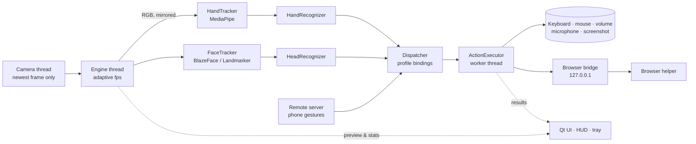

# Architecture

## Desktop

| Layer | Module | Notes |
|-------|--------|-------|
| Capture | `core/camera.py` | Reader thread overwrites a single frame slot; consumers wait on a condition for a newer frame. MSMF → DirectShow on Windows, AVFoundation on macOS, V4L2 on Linux. |
| Vision | `core/trackers.py` | MediaPipe Tasks in VIDEO mode, models loaded from memory. Light head mode uses BlazeFace keypoints, Accurate uses Face Landmarker + blendshapes. |
| Recognition | `core/hand.py`, `core/head.py` | Pure Python, no dependencies, unit-tested with synthetic hands/faces. Ported 1:1 to Kotlin and Swift. |
| Pointer | `core/pointer.py` | One-Euro filtered air mouse; head pointer as a joystick with dead zone and power curve. |
| Routing | `core/dispatcher.py` | Gesture → action via the effective profile; handles pause, practice mode, disabled gestures, repeat filtering. |
| Actions | `actions/` | Worker thread so slow actions (UI Automation, `osascript`) never block the camera loop. |
| Services | `services/` | Browser bridge, phone remote server, active-app watcher (auto profiles), autostart, global hotkey, permission checks. |
| UI | `ui/` | Qt Widgets with a token-based style sheet; every page rebuilds on language/theme change; HUD is a click-through tool window. |

### Engine loop

1. Wait for a newer frame (≤ 0.5 s).
2. Mirror + BGR→RGB.
3. Run the hand model and/or the face model. When both are enabled they **alternate frames**.
4. Feed recognisers → events → dispatcher.
5. Emit a preview (≤ 15 fps, only while the window is visible) and stats (2 Hz).
6. Sleep to the target rate: Eco 12 / Balanced 20 / Performance 30 fps, or **5 fps idle** after 3 s with nobody in view.

### Gesture state machines

- **Static poses** — finger extension from joint angles and wrist distances (rotation invariant), thumb and index direction with ±35° tolerance (diagonals ignored). A pose must be *stable for two frames*, then *held* for its hold time; it fires once and repeats only if the bound action is repeatable; the hand must change pose before it fires again. Fast hand motion (> 1.1 frame-heights/s) resets the hold timer.
- **Pinch** — hysteresis on thumb–index distance / palm size (enter 0.28, exit 0.42). Quick release = tap; held > 350 ms = drag mode emitting a step per 7 % of frame height.
- **Index-up joystick** — anchor on activation, dead zone 3.5 %, magnitude grows with distance; 90 ms between scroll ticks.
- **Swipe** — open palm in ≥ 60 % of a 0.45 s window, horizontal travel ≥ 30 % of frame height, 0.8 s refractory period.
- **Head** — yaw/pitch/roll from eyes and nose relative to a median baseline of the first 12 frames that slowly follows posture drift; holds need 450 ms beyond threshold; nod = quick dip and return; shake = three alternating yaw excursions in 1.4 s; expressions use hysteresis on blendshape scores.

### Threads

| Thread | Owner | Work |
|--------|-------|------|
| GUI | Qt | UI, HUD, screenshots, tray |
| `movo-camera` | Camera | Read frames |
| `movo-engine` | Engine | Vision + recognition |
| `movo-actions` | ActionExecutor | Key/mouse injection, audio, UI Automation |
| `movo-net` | asyncio loop | Browser bridge and remote server |
| `movo-active-app` | Controller | Foreground app polling every 1.2 s |

All cross-thread communication into the UI goes through queued Qt signals.

## Android

`GestureService` (camera foreground service, CameraX `ImageAnalysis` with keep-only-latest) → MediaPipe Tasks → Kotlin recognisers (same logic) → `ActionRunner` → `ControlService` (Accessibility: gestures, global actions, skip-ad node search, overlay HUD) or `RemoteClient`. UI is Jetpack Compose with Material 3, per-app language through AppCompat.

## iOS

`GesturePipeline` (AVCaptureSession 640×480, mirrored portrait) → Apple Vision hand pose + face landmarks → Swift recognisers → `AppModel` → in-app viewer commands or `RemoteClient`. SwiftUI interface.

## Remote protocol

See [REMOTE_PROTOCOL.md](REMOTE_PROTOCOL.md).
