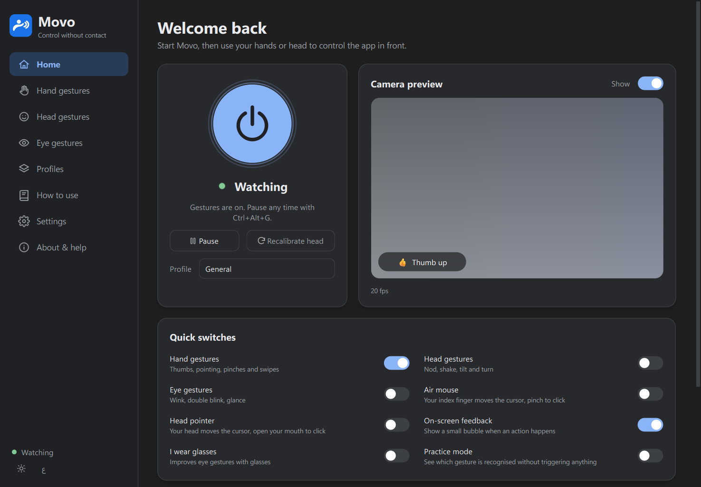
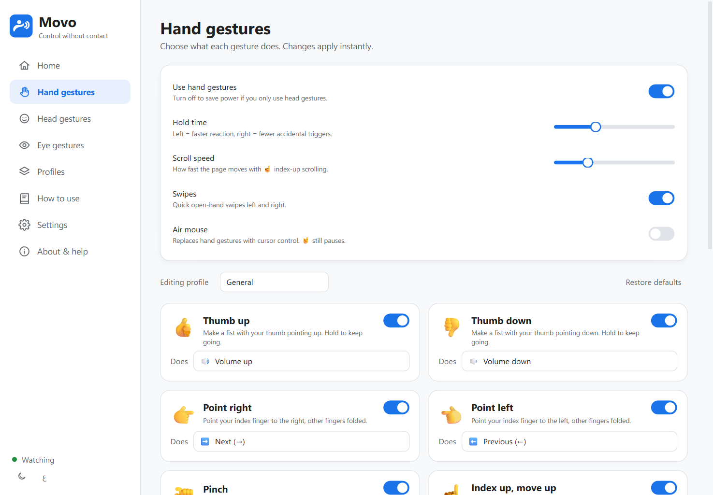
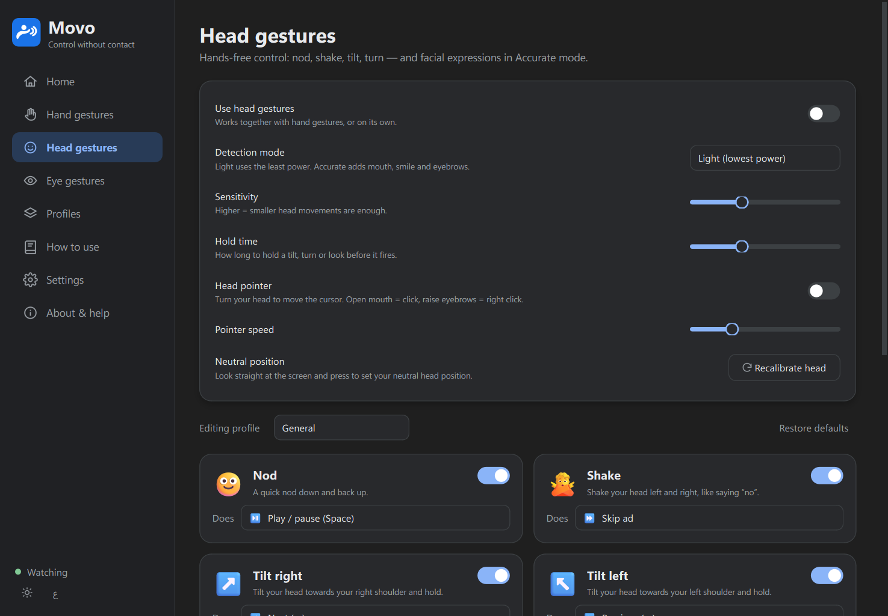
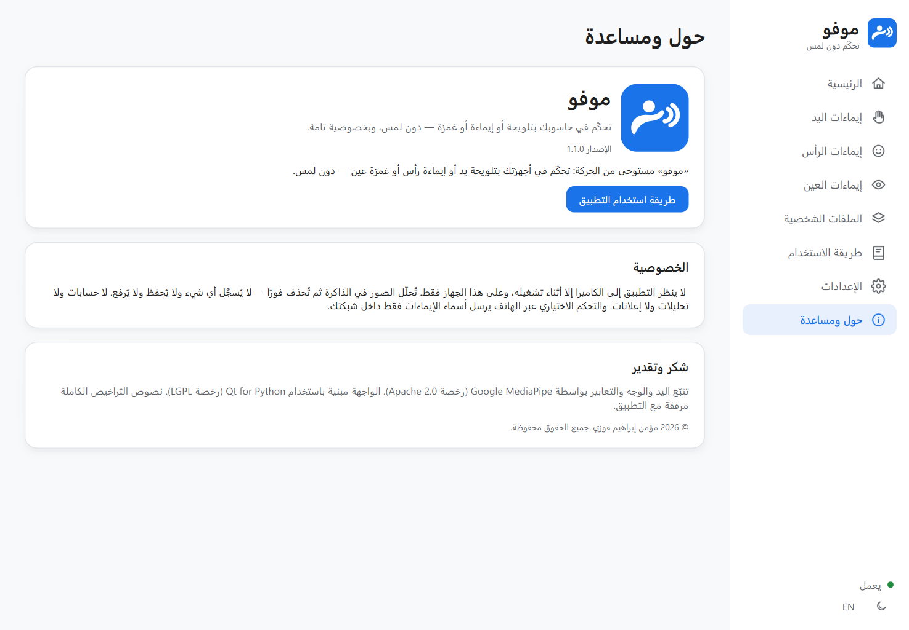
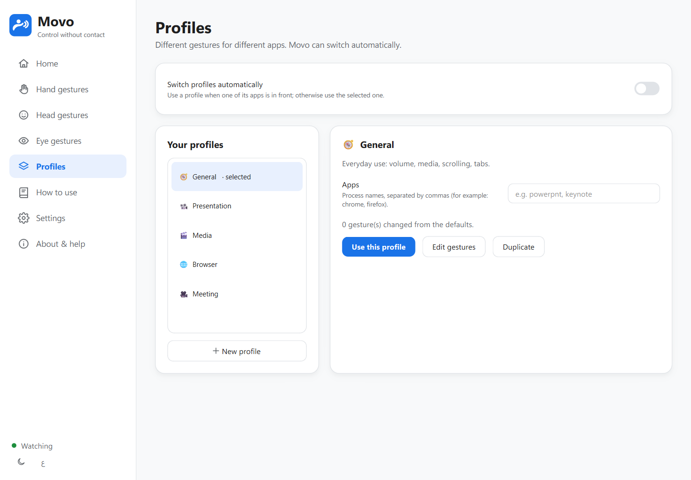
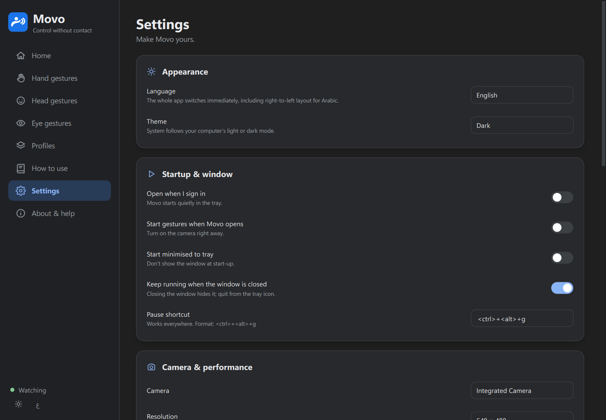

# Design system

## Brand

- **Name**: **Movo · موفو** — from "move". Four letters, the same sound in English and Arabic, playful but calm,
  and not tied to one body part (hands, head and eyes all *move*). Tagline: **Control Without Contact · تحكّم دون لمس**.
- **Logo**: a person in motion — a round head and one sweeping stroke (body and arm) sending two signal waves —
  white on a solid blue rounded square. The original artwork is in [`branding/concepts/`](../branding/concepts/); the
  production SVG is traced from it by `desktop/scripts/trace_logo.py`.
  Source: [`branding/logo.svg`](../branding/logo.svg); exports from 16 to 1024 px, `.ico`, `.icns`, Android adaptive icon and iOS app icon.
- **Colour approach**: calm and familiar, like Google and Apple apps — neutral greys, white surfaces and a single
  blue accent. No gradients; colour is used only for meaning (the accent for actions and selection, green/amber/red for status).

## Tokens

| Token | Light | Dark |
|-------|-------|------|
| Background | `#F8F9FA` | `#1F1F1F` |
| Sidebar / surface | `#FFFFFF` | `#202124` / `#28292C` |
| Surface alt | `#F1F3F4` | `#303134` |
| Border | `#E0E3E7` | `#3C4043` |
| Text | `#1F1F1F` | `#E8EAED` |
| Muted text | `#5F6368` | `#9AA0A6` |
| Accent (blue) | `#1A73E8` | `#8AB4F8` |
| Accent soft (selection) | `#E8F0FE` | `#283B57` |
| Success / warning / danger | `#1E8E3E` / `#E37400` / `#D93025` | `#81C995` / `#FDD663` / `#F28B82` |

Radii: 16 px cards, 10 px controls, pills fully rounded. Spacing: 8-point grid; pages have 32 px side margins on desktop, 18 dp on phones.

## Principles

1. **One big obvious control.** The power button is the first thing you see; its state (idle grey / solid blue with breathing rings / spinner while starting) is readable from across a room.
2. **Always show what the camera sees and what just happened.** Live pose overlay on the preview, a recent-actions feed, and a click-through HUD bubble for actions performed while the window is hidden.
3. **Learn by doing.** Practice mode lights up the matching gesture card without triggering anything; onboarding ends with a gesture tour.
4. **Safe by default.** Deliberate hold times, the 🤘 pause gesture, a global pause shortcut, and closing the window keeps the app in the tray — quitting is explicit.
5. **Bilingual from day one.** Every string is translated; Arabic switches the whole layout to right-to-left, including custom-painted switches.
6. **Respect resources.** Preview only while visible; idle mode when nobody is in view; power modes explained in plain words.

## Desktop layout

```
┌──────────┬───────────────────────────────────────────────┐
│ ◉ Movo   │  Welcome back                                 │
│          │  ┌─────────────┐ ┌──────────────────────────┐ │
│ ⌂ Home   │  │   ( ⏻ )     │ │  Camera preview   [on]   │ │
│ ✋ Hand   │  │  ● Watching │ │                          │ │
│ ☺ Head   │  │ Pause  Recal│ │      👍 Thumb up          │ │
│ ≋ Profile│  │ Profile [▾] │ └──────────────────────────┘ │
│ ⚙ Settings│ └─────────────┘                              │
│ ⓘ About  │  Quick switches (hand · head · air mouse …)   │
│          │  Recent actions                               │
│ ● Watching│ 🔒 Your camera picture stays on this device   │
│ ☾  ع     │                                               │
└──────────┴───────────────────────────────────────────────┘
```

The sidebar footer has a live status dot, a one-click theme switch and a one-click language switch.
In Arabic the sidebar moves to the right and every row mirrors.

## Mobile

- **Android**: Material 3 with the neutral + blue palette, bottom navigation (Home · Gestures · Remote · Settings), status bubble drawn by the Accessibility service, ongoing notification with Pause/Stop.
- **iOS**: native SwiftUI tab bar (Home · Viewer · Remote · Settings), SF Symbols, grouped backgrounds, system tint from the accent colour.

## Screenshots

| | |
|---|---|
|  |  |
|  |  |
|  |  |
|  |  |

Regenerate with `python desktop/scripts/screenshots.py`.
